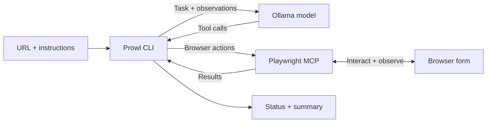

# Prowl

Prowl is a local AI browser testing CLI for forms. It uses an Ollama model and Playwright MCP to inspect a page, fill and submit a form, and report the visible outcome. Use it to try a registration flow with sample data or repeat that flow with different inputs.

## How it works

Give Prowl a form URL and optional instructions. The model chooses browser actions from each observation; Prowl runs them through Playwright MCP and returns the results to the model. The task ends when the model reports confirmation, a blocker, or uncertainty, or when the iteration limit is reached.



## Quick start

You need Node.js 24 or higher, pnpm, a running [Ollama](https://docs.ollama.com/cli) service with an available model that supports tool calls, and a browser supported by [Playwright MCP](https://github.com/microsoft/playwright-mcp). Prowl refuses to start on older Node versions. Playwright MCP starts through `npx`; its first launch may need network access or browser installation.

Clone the repository and install dependencies:

```bash
git clone https://github.com/Josh-Karp/prowl.git
cd prowl
pnpm install
cp .env.example .env
```

Set `OLLAMA_MODEL` in `.env` to the exact tag available on your Ollama service (`ollama ls` lists installed models). If needed, start the service with `ollama serve` and download a tool-capable model with `ollama pull <model>`.

Start the bundled form demo in one terminal, from the repository root:

```bash
pnpm demo
```

In a second terminal, also from the repository root, run:

```bash
pnpm prowl run http://localhost:5173
```

The demo serves its form at `/`. A live run requires Ollama and a working Playwright browser; routine repository tests do not.

## Usage

Pass your own HTTP or HTTPS form URL as the first argument to `run`. Quote URLs containing query parameters. For example:

```bash
pnpm prowl run 'https://example.com/register?source=trial' \
  --runs 2 \
  --instructions 'Use different synthetic customer details each time'
```

`--runs` requests sequential registrations. Each starts a fresh model conversation, while all runs share one iteration budget. Reporting requires a fresh inline browser snapshot for the current registration; the report tool becomes available after that observation. Reports returned before an observation are rejected within the existing iteration and recovery limits. A snapshot file link or historical observation does not satisfy this requirement. Prowl stops if a run is blocked or uncertain. The model interprets visible confirmation, so review its evidence when assessing a result.

Override the model, Ollama service, or shared iteration limit when needed:

```bash
pnpm prowl --model <model> --base-url http://localhost:11434 \
  --max-iterations 40 run https://example.com/register
```

Use `pnpm prowl --help` for global options and `pnpm prowl run --help` for form options. The checkout's [`.env.example`](.env.example) lists environment settings and their defaults. Prowl exits with code 0 only when every requested run is confirmed; blocked, uncertain, invalid, or failed runs exit with code 1. Console output shows progress and summaries. Detailed logs are written to a unique folder per invocation, based on `logs/prowl.log` by default; `--verbose` also prints details to the console.

## Tech

Prowl is a TypeScript ESM CLI on Node.js. Ollama provides model inference, Playwright MCP provides browser interaction, Commander parses arguments, and Zod validates inputs and results.

## Development

From the repository root, run the checks that match your change:

```bash
pnpm typecheck
pnpm test
pnpm lint
pnpm format:check
pnpm build
pnpm test:package
```

The regular tests need no live Ollama or browser. Run `pnpm test:package` for changes to the build, package contents, dependencies, CLI entry point, or installed paths. Checkout-only contributor guidance is in [AGENTS.md](AGENTS.md).

## Automated releases

The Release workflow uses Release Please v5 (Node.js 24) to open release PRs on pushes to `main` and create GitHub releases when those PRs merge. Both workflows use `ubuntu-24.04` to avoid automatic OS migrations of `ubuntu-latest`.

Under **Settings → Actions → General → Workflow permissions**, enable **Allow GitHub Actions to create and approve pull requests**. If Release Please reports that GitHub Actions is not permitted to create or approve pull requests, enable this setting and rerun the failed workflow. The workflow's `pull-requests: write` permission alone does not enable this repository setting; default workflow permissions can remain read-only.

## Local installation

Prowl is distributed as a local tarball; registry publishing is disabled. After `pnpm install`, create and install the current version from the repository root:

```bash
npm pack
npm install --global ./prowl-0.2.0.tgz
prowl --help
```

Run the installed command from your project directory:

```bash
prowl run https://example.com/register --model <model>
```

The installed CLI reads `.env` and writes relative log paths in your current directory. Set `OLLAMA_MODEL` there or pass `--model`; the tarball does not include `.env.example`. The tarball filename follows the version in `package.json`.
